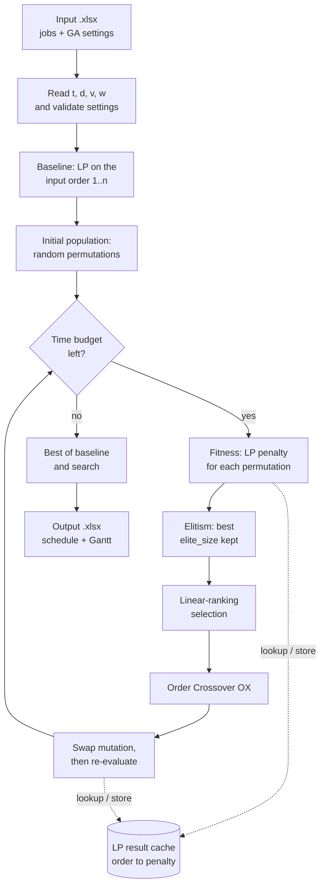

# Production Scheduling Optimization

**Schedules jobs on a single machine so that none of them finishes too early or too late — a genetic algorithm searches the job order, and a linear program times each order exactly.**

[](https://github.com/aradyaacovi/production-scheduling-optimization/actions/workflows/ci.yml)
[](https://www.python.org/)
[](https://coin-or.github.io/pulp/)
[](tests/test_smoke.py)
[](LICENSE)

A university project in Industrial Engineering (B.Sc. Industrial Engineering & Management), done in a team of two for a course on production planning. The program reads a problem instance from Excel, searches for a good schedule, and writes the schedule back to Excel with a Gantt row.

The code was written with AI tools (Cursor and Claude), working from our problem definition and requirements. [How this was built](#how-this-was-built-and-my-part) explains who did what.

---

## The problem

A factory has one machine and a set of jobs waiting for it. Each job `j` has:

| Symbol | Meaning |
|---|---|
| `t_j` | processing time |
| `d_j` | due date |
| `v_j` | penalty per time unit if the job finishes **early** (before `d_j`) |
| `w_j` | penalty per time unit if the job finishes **late** (after `d_j`) |

The machine processes one job at a time, and it may sit idle between jobs. The goal is to minimize total weighted earliness and tardiness:

```
minimize  Σ_j ( v_j · E_j + w_j · T_j )
where     E_j = max(0, d_j − C_j)   (earliness)
          T_j = max(0, C_j − d_j)   (tardiness)
          C_j = completion time of job j
```

This is a **just-in-time** objective. Finishing late costs money, and so does finishing early — the finished goods have to be stored and insured until the customer wants them. Because both directions are penalized, the best schedule sometimes leaves the machine deliberately idle instead of starting the next job straight away.

Finding the best order of `n` jobs by brute force means checking `n!` orders. For the 10-job example in this repository that is 3,628,800 orders, and it grows far faster than that. So the program searches the orders heuristically instead.

## What it does

- Reads jobs and solver settings from an Excel file
- Solves the schedule for the jobs in the order they appear in the file, as a baseline
- Runs a genetic algorithm over job orders for a time budget taken from the input file
- Times every candidate order exactly with a linear program, including idle time where that pays off
- Writes the best schedule found to an Excel file: per-job start, completion, earliness, tardiness and penalty, plus totals and a text Gantt row
- Reports the better of the baseline and the best order the search found, so its answer is never worse than the input order

## How it works

The problem splits into two decisions, and each is handled with the tool that suits it:

1. **Which order should the jobs run in?** There is no simple rule for this, so a **genetic algorithm** searches the space of orders.
2. **Given a fixed order, when exactly should each job start?** This part is a convex problem with a clean formulation, so a **linear program** solves it to optimality.

The second decision sits inside the first: the LP's optimal penalty for an order *is* that order's fitness in the GA.



### The linear program, for one fixed order

`solve_lp_subproblem` in [`Tapi_Project_Utils.py`](Tapi_Project_Utils.py) builds the model with PuLP and solves it with CBC. For `n` jobs it creates `3n` continuous non-negative variables — `C_j`, `E_j` and `T_j` — and these constraints:

| Constraint | Meaning |
|---|---|
| `C_first ≥ t_first` | the first job in the order cannot finish before it has been processed |
| `C_curr − t_curr ≥ C_prev` | each job starts no earlier than the previous job's completion, so the order is respected and waiting is allowed |
| `E_j ≥ d_j − C_j` | lower bound on earliness |
| `T_j ≥ C_j − d_j` | lower bound on tardiness |

The last two replace the non-linear `max(0, ·)`. Because the objective pays a positive price for both `E_j` and `T_j`, minimizing drives each one down to exactly `max(0, d_j − C_j)` and `max(0, C_j − d_j)`, so the pair behaves like the true earliness and tardiness while the model stays linear. Each solve gets a 5-second CBC time limit, and a status other than `Optimal` prints a warning.

Nothing forces the machine to start at time 0 or to run without breaks, which is what lets the LP insert idle time when waiting is cheaper than finishing early.

### The genetic algorithm

The main loop lives in [`Tapi_Project_GA_Engine.py`](Tapi_Project_GA_Engine.py), the operators in [`Tapi_Project_Utils.py`](Tapi_Project_Utils.py).

| Part | How it works |
|---|---|
| **Encoding** | one chromosome = one permutation of the job indices `0..n-1` |
| **Initial population** | `pop_size` independent random permutations |
| **Fitness** | the LP's optimal penalty for that order. Lower is better. |
| **Caching** | every solved order is stored in a dictionary keyed by the order as a tuple, so a repeated order is never solved twice. Orders repeat often once the population converges, and each LP solve is the expensive step. |
| **Elitism** | the best `elite_size` chromosomes move to the next generation unchanged and are not mutated |
| **Selection** | linear ranking: sorted best to worst, rank `N` down to `1`, probability = rank / sum of ranks. The best order is the most likely parent, but a weak order still has a chance, which keeps the population diverse. |
| **Crossover** | Order Crossover (OX). Two cut points are drawn; the segment between them is copied from one parent, and the remaining positions are filled from the other parent's order, skipping jobs already present. Both children are always valid permutations, so no repair step is needed. |
| **Mutation** | with probability `mutation_prob`, swap two random positions. A swap of a permutation is still a permutation. |
| **Stopping rule** | wall-clock time limit in seconds, read from the input file |

Two details worth noting, because they are easy to get wrong:

- **Mutation happens before evaluation.** Each generation mutates the non-elite children and only then computes their penalty, so the best-so-far record always refers to a chromosome as it actually is, not as it was before being mutated.
- **The baseline is part of the search.** Before the first generation the program solves the LP for the input order and seeds both the best-so-far record and the cache with it. The reported answer is therefore the better of the baseline and anything the GA found.

### Settings and their limits

The input file carries the GA settings, and `_validate_ga_parameters` enforces the course's rules:

| Setting | Rule |
|---|---|
| population size | must be 20–200; an odd value is rounded up to the next even number |
| elite size | must be at least 2 and at most 10% of the population; an odd value is rounded up |
| mutation probability | any numeric value |
| time limit | any numeric value, in seconds |

A missing or non-numeric setting raises a `ValueError` naming the parameter, rather than failing deeper in the run.

## Example: input → process → output

From one of our test runs on the bundled 10-job example (population 26, 2 elite, mutation 0.2, 100-second limit). Both result files are in [`examples/`](examples).

| | Penalty | File |
|---|---|---|
| **Baseline** — jobs in input order 1→10 | **250** | [`Output_Example_1_Stage1_input_order.xlsx`](examples/Output_Example_1_Stage1_input_order.xlsx) |
| **GA result** — 8,270 generations in 100 s | **207** | [`Output_Example_1_GA.xlsx`](examples/Output_Example_1_GA.xlsx) |

The order it found was `j1, j3, j4, j5, j2, j7, j6, j8, j9, j10`, with idle time inserted at 0–1 and 66–70. The idle gap before the very first job is the just-in-time objective at work: job `j1` has the highest earliness penalty in the instance (`v = 10`) and is due at `t = 3`, so the machine waits a time unit rather than finishing it early.

On this input the GA found an order with a **17% lower penalty** than the input order. This is one small example. The GA is a heuristic and does not guarantee an optimal schedule — results vary between runs, and on some inputs we tested it did not improve on the input order within the time limit. There are no benchmark numbers in this repository beyond this single documented run.

## Input and output format

**Input** — an Excel file, see [`examples/Input_Data_File_1_Example.xlsx`](examples/Input_Data_File_1_Example.xlsx):

| Where | Contents |
|---|---|
| Rows 1–5, from column B | job number, `t_j`, `d_j`, `v_j`, `w_j` — one column per job |
| Column A, row 7 | population size |
| Column A, row 9 | number of elite solutions |
| Column A, row 11 | mutation probability |
| Column A, row 13 | run-time limit, in seconds |

The number of jobs is taken from how many values row 2 holds, so the same layout works for any instance size.

**Output** — an Excel sheet named `Results`, one column per job *or idle period* in schedule order. Rows `Sj`, `Cj`, `Ej`, `Tj`, `Pj` give the start, completion, earliness, tardiness and penalty of each job; idle columns are marked `IDLE start-end` and filled in orange. Below the table come the total penalty, the baseline penalty (`Original Sol`), the number of generations, the run time, and a text Gantt row.

## How to run

Python 3.11 or newer. The team used 3.13; CI runs 3.11, 3.12 and 3.13.

```bash
pip install -r requirements.txt
```

Both entry points take the input and output file names **without** the `.xlsx` extension, and are called from Python rather than from the command line:

```bash
# Genetic algorithm. Runs for the time limit set in the input file (100 s for the example).
python -c "from Tapi_Project_GA_Engine import Run_GA; Run_GA('examples/Input_Data_File_1_Example', 'my_ga_result')"
```

```bash
# Baseline only: the LP on the input order, no search. Finishes in well under a second.
python -c "from Tapi_Project_Solver_Engine import Run_Solver; Run_Solver('examples/Input_Data_File_1_Example', 'my_solver_result')"
```

Run these from the repository root, so that the three modules are on `sys.path`. To call them from anywhere instead, install the project in editable mode:

```bash
pip install -e .
```

Two notes on running the scripts directly:

- `python Tapi_Project_GA_Engine.py` and `python Tapi_Project_Solver_Engine.py` do run, but their `__main__` blocks look for an input file named `Input_Data_File_2_Example.xlsx`, which was a second course input and is not part of this repository. Use the commands above, or edit the `INPUT_NAME` constant at the bottom of the file.
- The programs cannot overwrite an output file that is open in Excel; they report that as an error and stop.

## Tests

47 smoke-test checks in [`tests/test_smoke.py`](tests/test_smoke.py), with no test framework required:

```bash
python tests/test_smoke.py
```

They cover the three modules importing, reading the bundled example file, the LP reproducing the known penalty of 250 for the input order, the LP output satisfying the machine-order and earliness/tardiness relations, OX crossover and swap mutation preserving valid permutations over repeated trials, linear-ranking probabilities, every parameter-validation rule, the LP cache, and two end-to-end runs that write a workbook and check its contents. The end-to-end GA check uses a copy of the example input with a 3-second limit, so the suite finishes in a few seconds rather than the example file's 100.

[CI](.github/workflows/ci.yml) runs these on every push and pull request against Python 3.11, 3.12 and 3.13, after byte-compiling every module and confirming that PuLP can reach the CBC solver.

## Project structure

```
Tapi_Project_GA_Engine.py        genetic algorithm main loop (Run_GA)
Tapi_Project_Solver_Engine.py    baseline: LP on the input order only (Run_Solver)
Tapi_Project_Utils.py            LP model (PuLP), Excel read/write, GA operators, validation
tests/
  test_smoke.py                  47 smoke-test checks
examples/
  Input_Data_File_1_Example.xlsx          10-job sample instance
  Output_Example_1_Stage1_input_order.xlsx   baseline result, penalty 250
  Output_Example_1_GA.xlsx                   GA result, penalty 207
.github/workflows/ci.yml         CI: install, compile, solver check, smoke tests
pyproject.toml                   project metadata; enables `pip install -e .`
requirements.txt                 pandas, pulp (3.x), openpyxl
```

The module names come from the course assignment ("Tapi" is the course's abbreviation). They are kept as submitted; see [Possible next steps](#possible-next-steps).

Code comments are partly in Hebrew, the course language.

## Built with

| | |
|---|---|
| **Python 3.11+** | the whole program |
| **PuLP 3.x + CBC** | the linear program for exact job timing |
| **pandas** | reading the job table from Excel |
| **openpyxl** | reading the settings cells, and writing the formatted results sheet |
| **GitHub Actions** | CI across three Python versions |

## How this was built, and my part

This was a two-person project. We used AI tools throughout and declared them to the course:

- **Cursor** wrote and edited the code from the problem definition and requirements we gave it. It also fixed bugs, moved shared code into the `Utils` module, added the pandas-based input reading, and added comments.
- **Claude** checked the code against the project requirements, helped find bugs (input validation, duplicated code, the order of mutation and evaluation), and helped us understand and explain the GA logic.

My part, as one of the two team members:

- Defining the problem and the requirements the code was built from
- Working on the solution together with my teammate
- Testing the program and validating its outputs
- Processing and checking the input and output data, including with pandas

I did not write the genetic algorithm from scratch. My work was on the problem definition, the requirements, and checking that the program did what we specified.

## Changes made for this repository

The algorithm and the LP model are exactly as submitted. Everything that changed is around them:

- Removed the small GUI window (`Project_Form.py`) and its background image. The window was based on a course-provided template, so it is not included here; the program runs from Python, as shown above.
- Kept one example input and two of our own result files, and removed author metadata from them.
- Added this README, an MIT license, `pyproject.toml`, the smoke tests and the CI workflow.

## Possible next steps

Not done, and listed here rather than hidden:

- The three modules are still named `Tapi_Project_*` after the course assignment. Renaming them to something readable (`ga_engine.py`, `solver_engine.py`, `utils.py`) and moving them into a package would read better, at the cost of no longer matching the submitted files.
- A command-line interface (`python -m scheduling --input ... --output ...`) would be friendlier than the `python -c` one-liners.
- The run-time stopping rule could be joined by a convergence rule, for example stopping after a number of generations with no improvement.

## License

[MIT](LICENSE) © 2026 Arad Yaacovi

The course assignment, its input files and the problem definition belong to the course. The license covers the code in this repository.
